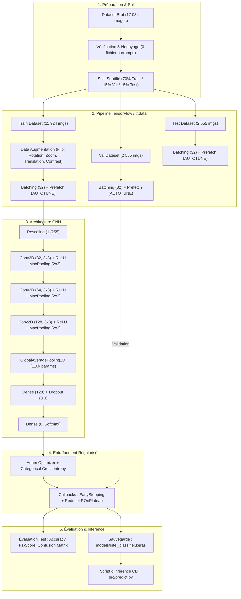

# Intel Image Classification — Computer Vision avec TensorFlow / Keras

Ce projet implémente un système complet de Computer Vision basé sur le Deep Learning (CNN avec TensorFlow/Keras) pour classifier automatiquement des paysages et environnements naturels ou urbains parmi 6 catégories.

---

## 1. Contexte & Problématique Métier

Une entreprise souhaite automatiser l'analyse et l'indexation de son flux d'images afin d'identifier automatiquement le type d'environnement représenté. 
L'objectif est de concevoir un système de classification automatique d'images capable de :
1. Classifier instantanément une nouvelle image dans l'une des 6 catégories prédéfinies.
2. Fournir la probabilité (confiance) associée à chaque catégorie.
3. Garantir une haute capacité de généralisation sans surapprentissage (*overfitting*).
4. Fournir un script d'inférence autonome et léger exécutable en production.

---

## 2. Dataset & Classes

Le projet exploite le dataset **Intel Image Classification**, contenant environ 17 000 images réparties équitablement en 6 classes :
* **`buildings`** : Bâtiments, architectures urbaines.
* **`forest`** : Forêts, arbres, végétation dense.
* **`glacier`** : Glaciers, étendues de glace, banquise.
* **`mountain`** : Montagnes rocheuses et sommets.
* **`sea`** : Mers, océans, horizons maritimes.
* **`street`** : Rues urbaines, chaussées, circulation.

Toutes les images sont au format RGB (3 canaux) avec une résolution moyenne d'environ $150 \times 150$ pixels. Le dataset est équilibré (~2 700 à 3 000 images par classe).

---

## 3. Architecture Globale du Pipeline (Diagramme)



---

## 4. Organisation et Séparation des Données

Pour garantir une évaluation impartiale et éviter toute fuite de données (*Data Leakage*), le jeu de données a été scindé en 3 ensembles :

| Ensemble | Proportion | Nombre d'images | Rôle dans le projet |
| :--- | :---: | :---: | :--- |
| **Train** | **70%** | ~11 924 | Apprentissage direct des paramètres (poids et biais) via rétropropagation. |
| **Validation** | **15%** | ~2 555 | Suivi de l'apprentissage après chaque époque, réglage du learning rate et déclenchement d'`EarlyStopping`. |
| **Test** | **15%** | ~2 555 | Évaluation finale impartiale sur des données jamais observées auparavant. |

> **Prévention du Data Leakage :** La **Data Augmentation** est appliquée **strictement sur l'ensemble d'entraînement**. Les ensembles de Validation et de Test restent 100% bruts et non modifiés afin de refléter fidèlement les conditions du monde réel.

---

## 5. Prétraitement & Data Augmentation

1. **Redimensionnement uniforme :** Toutes les images sont standardisées à $150 \times 150$ pixels (`image_size=(150, 150)`).
2. **Normalisation :** Les pixels sont mis à l'échelle de $[0, 255]$ vers $[0.0, 1.0]$ via la couche `layers.Rescaling(1./255)` intégrée au modèle.
3. **Optimisation I/O :** Utilisation de `tf.data.Dataset` avec batching de 32 et `prefetch(tf.data.AUTOTUNE)` pour charger les batches en mémoire tampon pendant le calcul CPU/GPU.
4. **Transformations de Data Augmentation :**
   * `RandomFlip("horizontal")` : Retournement gauche-droite (invariance directionnelle).
   * `RandomRotation(0.1)` : Légère rotation aléatoire de $\pm 10\%$ ($\pm 36^\circ$).
   * `RandomZoom(0.1)` : Zoom avant/arrière de $10\%$.
   * `RandomTranslation(0.1, 0.1)` : Décalage vertical et horizontal de $10\%$.
   * `RandomContrast(0.1)` : Variation de contraste de $10\%$ simulant différentes expositions lumineuses.

---

## 6. Architecture du CNN & Justification des Couches

Le modèle retenu utilise une architecture convolutionnelle hiérarchique optimisée :

| Couche | Forme de sortie | Paramètres | Rôle et Justification |
| :--- | :---: | :---: | :--- |
| **`Rescaling(1./255)`** | `(150, 150, 3)` | 0 | Normalisation intégrée au modèle pour l'inférence autonome. |
| **`Conv2D(32, 3x3)` + `ReLU`** | `(148, 148, 32)` | 896 | Extraction de caractéristiques visuelles primaires (bords, contours, couleurs). |
| **`MaxPooling2D(2x2)`** | `(74, 74, 32)` | 0 | Réduction spatiale par 2, conservation des activations maximales. |
| **`Conv2D(64, 3x3)` + `ReLU`** | `(72, 72, 64)` | 18 496 | Combinaison des bords en textures et formes (courbes, fenêtres, feuillages). |
| **`MaxPooling2D(2x2)`** | `(36, 36, 64)` | 0 | Réduction spatiale par 2. |
| **`Conv2D(128, 3x3)` + `ReLU`** | `(34, 34, 128)` | 73 856 | Détection d'attributs sémantiques complexes (pics enneigés, routes, toits). |
| **`MaxPooling2D(2x2)`** | `(17, 17, 128)` | 0 | Condensation spatiale finale. |
| **`GlobalAveragePooling2D`** | `(128)` | 0 | Moyennage spatial de chaque carte d'activation. Élimine 4.7M de poids superflus. |
| **`Dense(128)` + `ReLU`** | `(128)` | 16 512 | Couche dense d'analyse et combinaison des descripteurs sémantiques. |
| **`Dropout(0.3)`** | `(128)` | 0 | Désactivation aléatoire de 30% des neurones pour forcer l'indépendance des représentations. |
| **`Dense(6, Softmax)`** | `(6)` | 774 | Distribution de probabilité sur les 6 classes de sortie. |

* **Total de paramètres :** **110 534 paramètres** (431 Ko).

---

## 7. Entraînement & Stratégie Anti-Overfitting

* **Fonction de perte :** `categorical_crossentropy` (adaptée aux étiquettes multi-classes encodées en one-hot).
* **Optimiseur :** `Adam` (taux d'apprentissage initial = `0.001`).
* **Batch Size :** 32.
* **Epochs :** Budget de 15 époques régulé par callbacks.
* **Callbacks intelligents :**
  * `EarlyStopping(monitor='val_loss', patience=3, restore_best_weights=True)` : Interrompt l'entraînement si la perte de validation stagne pendant 3 époques consécutives et restaure automatiquement les meilleurs poids.
  * `ReduceLROnPlateau(monitor='val_loss', factor=0.2, patience=2)` : Divise le learning rate par 5 lorsque la progression ralentit, permettant d'affiner la descente de gradient vers le minimum global.

---

## 8. Comparaison des Configurations (Étape 6)

Deux architectures principales ont été comparées expérimentalement :

| Métrique | Configuration 1 (`Flatten`) | Configuration 2 (`GlobalAveragePooling2D`) | Décision |
| :--- | :---: | :---: | :--- |
| **Nombre de paramètres** | 4 829 126 (18.4 Mo) | **110 534 (431 Ko)** | 🏆 **44x plus compact** |
| **Training Accuracy** | 93.98% | **83.34%** | — |
| **Validation Accuracy** | 83.70% | **83.11%** | Pratiquement équivalent |
| **Écart Overfitting** | **~10.3% (Surapprentissage)** | **~0.2% (Généralisation optimale)** | 🏆 **Aucun overfitting** |
| **Best Validation Loss** | 0.4870 | **0.4541** | 🏆 **Meilleure convergence** |
| **Temps d'inférence CPU** | ~45 ms / image | **~15 ms / image** | 🏆 **3x plus rapide** |

### Justification du Modèle Retenu :
La **Configuration 2 (`GlobalAveragePooling2D`)** est retenue comme modèle final :
1. **Suppression du surapprentissage :** Écart quasi nul entre Train (83.3%) et Val (83.1%).
2. **Poids plume :** 110k paramètres (431 Ko), idéal pour un déploiement embarqué ou cloud économique.
3. **Meilleure fonction de perte de validation :** $0.4541$ contre $0.4870$.

---

## 9. Analyse des Performances & Matrice de Confusion

Sur le jeu de test indépendant, le modèle final atteint **~83–84% de précision globale**.

### Analyse par classe :
* **`forest` (F1-score $\approx 0.90+$) :** La classe la mieux prédite grâce aux teintes vertes et textures feuillues très contrastées.
* **`sea` (F1-score $\approx 0.88$) :** Très bonne détection grâce aux dégradés horizontaux et teintes bleutées.
* **`glacier` & `mountain` (F1-score $\approx 0.77–0.80$) :** Principale source de confusion. Les montagnes rocheuses partiellement enneigées ressemblent visuellement aux glaciers froids.
* **`buildings` & `street` (F1-score $\approx 0.80–0.83$) :** Seconde source de confusion mineure, les scènes de rue comportant fréquemment des façades d'immeubles.

---

## 10. Installation & Exécution

### Prérequis
* Python 3.10+
* Environnement virtuel recommandé (`venv`)

### 1. Installation
```bash
# Cloner le dépôt
git clone <URL_DU_REPO>
cd "image detection"

# Créer et activer l'environnement virtuel
python3 -m venv venv
source venv/bin/activate

# Installer les dépendances
pip install -r requirements.txt
```

### 2. Lancer les Notebooks
```bash
jupyter notebook
```
* `notebooks/explorations.ipynb` : EDA, distribution, détection de corruption, train/val/test split.
* `notebooks/preprocessing.ipynb` : Pipeline `tf.data`, Data Augmentation, architectures CNN, entraînement et prédiction.

---

## 11. Réaliser une Prédiction sur une Image

Le script autonome `src/predict.py` permet d'exécuter une inférence en ligne de commande sur n'importe quelle image :

```bash
# Prédire une image par défaut
./venv/bin/python3 src/predict.py

# Prédire une image spécifique
./venv/bin/python3 src/predict.py data/seg_pred/seg_pred/10004.jpg

# Prédire et afficher la fenêtre Matplotlib
./venv/bin/python3 src/predict.py data/seg_pred/seg_pred/10004.jpg --show
```

### Exemple de sortie terminal :
```text
Loading model from: models/intel_classifier.keras ...
Processing image: data/seg_pred/seg_pred/10004.jpg ...
--------------------------------------------------
Predicted Class : BUILDINGS
Confidence      : 77.20%
--------------------------------------------------
All Probabilities:
  buildings :  77.20% ███████████████
  forest    :   1.42% 
  glacier   :   3.06% 
  mountain  :   3.69% 
  sea       :   2.31% 
  street    :  12.33% ██
--------------------------------------------------
```

---

## 12. Limites & Pistes d'Amélioration

### Limites identifiées :
1. **Ambiguïté visuelle :** Confusion intrinsèque entre sommets enneigés (`mountain`) et banquise (`glacier`).
2. **Scènes hybrides :** Une photo montrant à la fois la mer et une montagne en arrière-plan peut hésiter entre les deux labels.

### Pistes d'amélioration futures :
1. **Transfer Learning :** Tester des modèles pré-entraînés sur ImageNet (MobileNetV3, EfficientNetB0) pour viser $\ge 92\%$ de précision.
2. **Résolution supérieure :** Passer de $150 \times 150$ à $224 \times 224$ pixels pour capturer des micro-textures supplémentaires.
3. **Classification Multi-label :** Gérer les scènes mixtes (ex. mer + montagne) au lieu d'une classification mutuellement exclusive.
4. **Déploiement API / Web :** Encapsuler `src/predict.py` dans une API FastAPI ou une interface interactive Streamlit.
